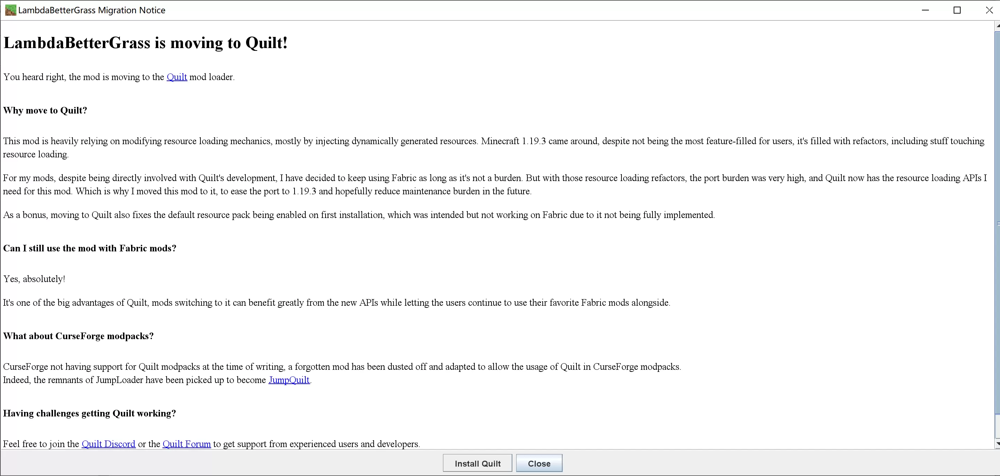

# Open Grass

**中文** | [English](README.md)

LambdaBetterGrass 的 1.21.1 NeoForge 移植。

使用原模组 1.5.2 版本以 MIT 开源的代码。

## 这是什么模组？

你使用过 LambdaBetterGrass 的更好的草地功能吗？作者用过，很喜欢，但对它有点意见。作者认为主要问题是，即使在其许可证所规定的最开放的条件下，它也过于封闭，这就是为什么作者自己再创作了一个模组来解决这个问题，并为 NeoForge 生态系统上的 LambdaBetterGrass 功能提供一个替代品！现在草方块会连接起来，附近的草方块也会被平滑过渡。

## 功能

- 连接草方块；

- 连接菌丝体方块；

- 连接灰化土方块；

- 连接土径方块；

- 连接绯红菌岩方块；

- 连接诡异菌岩方块；

- 启用“更好的雪地”时，为许多非完整方块添加雪层；

- 启用“更好的雪地”时，为许多非完整方块添加覆地苔藓；

- ~~添加一个可选的内置资源包，即可拥有覆雪的栅栏；~~ 本模组资源包改为直接内嵌

- ~~为资源包制作者和模组开发者提供 API，以便为遵循更好的草地规则添加新的方块连接，或为遵循更好的雪地规则的方块添加新的备用模型；~~ 这件事情是 LambdAurora 的成果，与本模组没有关系

- 还有更多！

## 使用方法

使用该模组非常简单！

将其安装到你的 mods 文件夹中，不需要任何前置。

你会发现有些方块（如草方块）会连接在一起，如果你想尝试其他选项或想拥有与 OptiFine 相同的外观，可以通过 NeoForge 模组菜单查看该模组的设置界面。

### 构建

`./gradlew build` 以进行自动化构建。

### 对资源包制作者和开发者

理论上仍然应该查看[那个文档](https://lambdaurora.dev/projects/lambdabettergrass/documentation/)，API 应当不会变动。

## 兼容性

理论上 LambdaBetterGrass 的兼容性会延伸到本模组上。

## 一些想法

> 攻击性预警

平心而论，我认为 LambdAurora 是个有点虚伪的人。我并不否认他的动态光源模组质量很高，本模组的质量也不错。但正如 Forge 的成功无法掩盖 LexManos 的人品一样，某些人的本性也不是几句话就能遮住的。

### 关于开源

LambdAurora 曾经口口声声说着什么“本模组开源的原因是：鼓励贡献。这正是高清修复等模组因其封闭源代码而无法利用的地方，作者将其开源，因此如果作者很忙，或缺少技术知识，仍有可能对其进行改进和更新”之类的。他还制作了一个 [OptiFine Alternatives](https://optifine.alternatives.lambdaurora.dev/) 帮助玩家选择 OptiFine 的替代品。

嗯，对，听起来很伟大。实际上也很伟大。

但我必须提问：[The Lambda License](LICENSE.theMostOpen) 真的是一个“开源”许可证吗？

开源最基本的定义，自由使用、研究、修改和再分发，您真的做到了吗？

我暂且不提他的 Copyleft 条款，毕竟 AGPL 也是这么做的，而且我其实也是 Copyleft 派。我就提几条：

```LICENSE
3.3. You must obtain written approval from all Project Owners to use their
work as mentioned above.

3.3.1.1. Revocation can be pronounced at any time (known as the "Revocation
Date") by any Project Owner, upon written notification to You.

3.3.2. The Project Owner may impose any additional clause on their
authorization within the limits provided in 3.3.1.
```

说难听点，这和 All Rights Reserved 的本质区别在哪？

为了防止有人说我双标，我要提到另一个更换许可证的模组：[Sodium](https://github.com/CaffeineMC/sodium)。

CaffeineMC 在 GitHub Issue [#2400](https://github.com/CaffeineMC/sodium/issues/2400) 中详细阐释过他们更换许可证的原因——简而言之，作者只是希望那些移植他们模组的人能够以负责任的方式行事。

我也认为他们有点虚伪，但至少 PolyForm Shield License 没有那么多的许可限制，而作者面对的大量用户就与他们无关的问题向他们寻求帮助的情况也是客观存在的。而在那之后他们也再也没有说过 Sodium 是一个自由且开源的模组。

那么 The Lambda License 呢？

```LICENSE
The Lambda License is an open license meant to better protect the rights of
software authors. It does not adhere to the usual definition of "Free Open
Source Software" (FOSS), but rather we aim to strike a middle ground between
the freedom of consumers and the protection of the authors' work.

We believe traditional FOSS licenses allow companies or other individuals to
exploit software authors freely by having their work shared in a way they
don't agree with or that is detrimental to their business. This license aims
to give control of artifacts back to the authors and support an open code
community, while still allowing source code to be easily modified and shared.
```

我不知道您到底 Open 在哪，简直和 OpenAI 一样 Open 呢。我们一般管这种行为叫趴在开源社区身上吸血，还标榜自己是开源先锋。

吸社区血这种事情我已经见怪不怪了，说实话无可厚非。但你仍然标榜自己开源是不是有点又当又立了？

### 关于 Quilt

这一点更难绷。

我自始至终都没有明白，Quilt 到底是有多么的优秀，能让你专门设计一个弹窗来骚扰 Fabric 端的玩家。你大可以直接崩掉，写这么一段 Mixin 还真是辛苦你了。



优秀得都要死掉了呢，你后面的模组怎么又转头支持 Fabric 去了？

> 顺带一提，这个版本除了弹窗之外其实根本不能在 Fabric 上启动，点 Close 会直接结束 JVM，就算绕过去了，`MainMixin` 也会导致整个游戏入口被吃掉，游戏永远不会启动，再就算又绕过去了，它在什么地方调用 Quilt 的 API 的时候 Mixin 注入失败依然会崩溃。详见 [LambdAurora 此生最伟大的代码](docs/MigrationNotice.java)

> 不是阴阳，我是真的觉得很伟大，他对 Mixin 的应用已经出神入化了

Forge 的分支 NeoForge 大有一统天下之势，但 Fabric 的分支 Quilt 怎么看起来不太健康啊。哦对了，你好像也是 Quilt 开发者团队的一员吧，你们有什么头绪吗？

我猜一定不是因为 Quilt 更新比当年它蛐蛐的 Fabric 还慢，稳定性没高到哪去甚至有些时候还更低了，说是面向社区实际上你真面向社区吗，还要在别人玩 Fabric 的时候跳个弹窗强行推销吧。

当然，我并不否认你乃至整个 Quilt 团队的人品还是比 LexManos 好了许多的。而且 Quilt 团队水平并不低，毕竟是他们做出了 Vineflower 这个很好用的现代化 Java 反编译工具。但在运营上，他们的水平似乎并不高。

> 我猜有人会说：啊你个只会 Vibe 的哪里来的脸骂人家

那你骂我呗。我能骂他，你当然也可以骂我。当然你如果要骂，也请像我骂他一样骂的有逻辑一点。

开源就是大于封闭的，我一直这么认为。

## 许可证

双许可证：MIT 或 The Lambda License，随便你选哪个。

## 致谢

感谢 [LambdAurora](https://github.com/LambdAurora) 开发并开源 LambdaBetterGrass 1.5.2 及更早版本

感谢[杭州深度求索人工智能基础技术研究有限公司](https://www.deepseek.com)为本模组提供代码支持

**感谢每一位 Minecraft 开源社区的创作者们**
